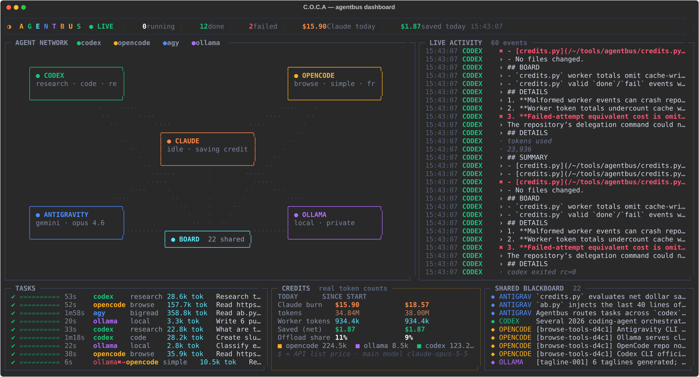
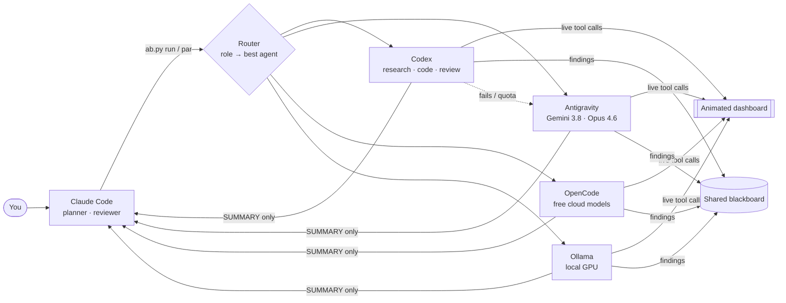

<div align="center">

# 〚 C.O.C.A 〛

### Claude Orchestrating Cheaper Agents

**Claude plans. Cheaper agents do the heavy lifting. You watch every task, and every credit, live.**

[](LICENSE)




<sub>A real frame from the dashboard: four agents ran one job in parallel, and the credits panel counts real tokens.</sub>

</div>

---

## Why

Claude is the best planner and reviewer you have, and also the most expensive. Most of what it spends tokens on isn't judgment. It's reading 30 web pages, scanning a log file or writing boilerplate.

**〚 C.O.C.A 〛 turns Claude Code into a manager.** Claude splits the work, sends each piece to the agent best suited to it, and gets back a **short summary** instead of the raw pages. The tokens burned on the heavy work go to cheaper or free models: your ChatGPT plan (Codex), your Google plan (Antigravity), free cloud models (OpenCode), or a model running on your own GPU (Ollama).

## Features

- 🧠 **Claude stays the brain.** It plans, verifies and decides. The workers execute.
- 🔀 **Each task type goes to the best-fit agent**: research, browse, code, review, big reads, simple jobs, private local work.
- 🛟 **Automatic fallback.** If an agent fails, hits a quota or is offline, the next one in the chain takes over.
- 📡 **Live animated terminal dashboard**: packets fly between agents, every tool call is streamed, tasks show progress, and findings land on a shared board.
- 💰 **Real credit accounting.** Claude's usage comes from Claude Code's own transcripts, and worker usage from the token counts each CLI reports. Nothing is estimated from character counts.
- 🧾 **Shared blackboard.** Every agent sees what the others found and adds its own durable findings.
- 🔁 **Switch models anytime**, per agent and per role (`ab.py models set agy review claude-opus-4-6-thinking`).
- 🔒 **Safe by default.** No auto-approve-everything modes, codex is sandboxed, read-only roles can't edit your project, and `local` tasks never leave your machine.
- ⚙️ **Starts itself.** A Claude Code session-start hook opens the dashboard and boots Ollama with your model folder.

## How it works



**The life of one task**

1. Claude calls `ab.py run research "…"`. The router picks the chain for that role, for example `codex → agy → opencode`.
2. The prompt is wrapped with the recent shared blackboard and a strict `SUMMARY / BOARD / DETAILS` output format.
3. The worker CLI runs headless. Its tool calls (searches, page fetches, file reads, edits) are converted into readable lines and streamed to `live.log`, so the dashboard can animate them.
4. When it finishes, `BOARD` lines are added to the blackboard, the token usage the CLI reported is written to the event bus, and **only the `SUMMARY`** is printed back to Claude.
5. If the attempt fails (non-zero exit, empty answer or quota error), the next agent in the chain gets the same task.

Everything is plain files under `~/.agentbus/`: `bus.jsonl` (event timeline), `BOARD.md` (shared memory), `tasks/<id>/` (prompt, live log, full output) and `models.json` (your model choices).

## Routing (defaults)

| Role | Use for | Chain (first → fallback) |
|---|---|---|
| `research` | Multi-source web research | **Codex** → Antigravity (Gemini 3.8 Flash High) → OpenCode |
| `browse` | Read specific URLs, extract facts | **OpenCode** (free) → Codex → Antigravity |
| `code` | Implement, refactor, write tests in `-C <repo>` | **Codex** (sandboxed, high effort) → Antigravity (Opus 4.6 Thinking) → OpenCode |
| `review` | Read-only code review | **Codex** → Antigravity → OpenCode |
| `bigread` | Summarise huge files, logs, unfamiliar repos | **Antigravity** (huge context) → OpenCode → Codex |
| `simple` | Rewrite, classify, extract, format | **Ollama** (local) → OpenCode → Antigravity |
| `local` | Private data | **Ollama only.** Never leaves your machine. |

These defaults come from testing, not guesswork. For example, Codex gave the most precise code reviews, so it leads `review`.

## Quick start

**1. Install whichever worker CLIs you want** (any subset works; missing agents are skipped):

| Agent | Windows | macOS / Linux |
|---|---|---|
| [Codex CLI](https://github.com/openai/codex) | `powershell -c "irm https://chatgpt.com/codex/install.ps1 \| iex"` | `curl -fsSL https://chatgpt.com/codex/install.sh \| sh` |
| [Antigravity CLI](https://antigravity.google) | `irm https://antigravity.google/cli/install.ps1 \| iex` | `curl -fsSL https://antigravity.google/cli/install.sh \| bash` |
| [OpenCode](https://github.com/anomalyco/opencode) | `npm i -g @opencode/cli@latest` | `curl -fsSL https://opencode.ai/v2/install \| bash` |
| [Ollama](https://ollama.com) | `irm https://ollama.com/install.ps1 \| iex` | `curl -fsSL https://ollama.com/install.sh \| sh` |

Sign in to each one once (`codex`, `agy`, `opencode`) and pull a model for Ollama (`ollama pull qwen3:8b`).

**2. Install 〚 C.O.C.A 〛 into Claude Code**

```bash
git clone https://github.com/avanishkasar/〚 C.O.C.A 〛-Orchestrator.git
cd 〚 C.O.C.A 〛-Orchestrator
python install.py          # skill + CLAUDE.md rule + allow rule + session-start hook (backs up every file it touches)
python coca/ab.py doctor   # sends a tiny real task to every agent
```

That's it. Open Claude Code, give it a research-heavy task, and watch the dashboard.

## Commands

```bash
python coca/ab.py run research "Compare the top 3 vector DBs for a 10M-row RAG app"
python coca/ab.py run code "Add pagination to the /users endpoint with tests" -C ./my-api
python coca/ab.py run review "Review the diff on this branch for bugs" -C ./my-api
python coca/ab.py par examples/jobs.json -j 4       # several agents at once
python coca/ab.py dash                             # open the live dashboard
python coca/ab.py credits                          # Claude burn vs. work offloaded
python coca/ab.py models list                      # every model each agent can use
python coca/ab.py models set ollama simple gemma4:e4b
python coca/ab.py up                               # start dashboard + Ollama, check CLIs
```

## Credit accounting: real numbers, not vibes

| Number | Source |
|---|---|
| **Claude burn** | Every assistant message in `~/.claude/projects/**/*.jsonl` (Claude Code's own transcripts, subagents included), deduplicated by message id, using the exact `usage` the API returned. Priced at Anthropic API list prices, including cache reads and writes. |
| **Worker tokens** | The token counts each CLI reports itself: Codex `tokens used`, Antigravity `usage` events, OpenCode `step_finish` tokens, and Ollama `prompt_eval_count`/`eval_count`. |
| **Saved (net)** | Worker tokens from *successful* tasks, priced as if Claude had processed them, minus the summary Claude still has to read. Failed attempts count as zero savings. |

Subscription plans don't bill per token, so dollar amounts are API-equivalent values. The token counts are exact.

## The dashboard

`ab.py dash` (opens by itself on Windows Terminal) shows:

- **Agent network**: Claude in the center and the workers around it. Busy agents spin and light up their connection, and packets labelled `research`, `summary`, `finding` and `fallback` fly between nodes.
- **Live activity**: every search, page fetch, command, edit and line of reasoning from every agent, as it happens.
- **Tasks**: progress bars, durations, the model used, real token counts and fallback chains (`opencode✖→codex`).
- **Credits**: Claude's spend today and since install, worker tokens, net saved and offload share.
- **Shared blackboard**: findings the agents have shared with each other.

It won't close by accident. Ctrl+C is ignored while workers are running, and if the window is closed mid-task it reopens within a few seconds.

## Configuration

| Setting | What it does |
|---|---|
| `~/.agentbus/models.json` | Model per agent per role (edit with `ab.py models set`). |
| `AB_DASH=0` | Don't auto-open the dashboard. |
| `AB_TABS=1` | Also open a raw output tab for each worker. |
| `AGENTBUS_HOME` | Move the data folder (default `~/.agentbus`). |
| `OLLAMA_MODELS` | Read when Ollama is auto-started. If a running Ollama can't see this folder, 〚 C.O.C.A 〛 restarts it with the right path. |

## Related projects

Others are exploring multi-agent CLI orchestration too, including [Orchestra Code](https://github.com/crossben/orchestra-code), [Ariadne](https://github.com/haha-systems/ariadne), [ai-dispatch](https://github.com/agent-tools-org/ai-dispatch), [Hydra](https://github.com/krowxx/hydra) and [agent-orchestrator](https://github.com/willynikes2/agent-orchestrator). 〚 C.O.C.A 〛's angle is the combination: **Claude stays the planner inside Claude Code**, every task type has a tested best-fit agent with fallback, everything is visible in a live dashboard, and the savings are **measured from real token counts**.

## Built with itself

The research behind this README was done by 〚 C.O.C.A 〛. In one parallel job, **Codex** researched comparable projects, **OpenCode** read each vendor's install page, **Antigravity** read the source and wrote the architecture summary, and the local **Ollama** model drafted taglines. Claude only planned the job and edited the results.

## Roadmap

- [ ] macOS/Linux dashboard auto-launch (tmux / iTerm)
- [ ] Cost-aware routing (prefer whichever agent still has quota today)
- [ ] Per-task quality scoring to auto-tune routes
- [ ] More workers (Aider, Goose, Qwen Code)

## License

[MIT](LICENSE) © Avanish Kasar
